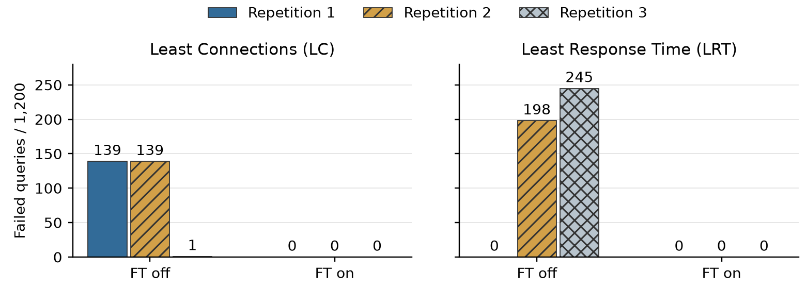

# Phase 4 report draft — ADS Group 44

[IEEE LaTeX section and standalone preview](phase4-report.tex).
This file mirrors the Phase 4 section, conclusion and figure added to the shared
Overleaf report. The Phase 4 body is approximately 350 words, excluding the figure
caption; the group conclusion adds approximately 100 words.
Detailed measurements are in [the experiment analysis](../results/phase4/matrix-20261007/analysis.md);
live figures and captions are in [the screenshot guide](../results/phase4/live-demo-2026-10-07/README.md).

## Phase 4: Fault Tolerance

Stopping a replica in Phase 3 caused some new RPyC connections to fail with `EOFError`: the balancer could still select a stopped server. We therefore added health monitoring before backend selection.

### Failure detection and recovery

Each replica process exposes a TCP `PING`/`PONG` endpoint, available once its RPC listener is ready. Independent probes run every 1 s with a 0.5 s timeout. Two consecutive failures exclude a replica; two successes admit it. Initially unknown replicas are excluded, and failed replicas remain under observation. Least Connections (LC) and Least Response Time (LRT) select only healthy replicas; probe traffic does not affect their connection counts or latency estimates.

A failed backend connection also causes immediate exclusion. Another healthy replica is tried only before application data is forwarded, with a 0.5 s connection timeout. On recovery, LRT resets the replica's latency estimate so that it can receive a fresh sample.

### Evaluation

We evaluated LC and LRT with fault tolerance (FT) off/on, repeating each condition three times: 12 runs and 14,400 queries. Each run used fresh application containers and a warmed cache for `the / mansfield-park` (expected count 6208). At 20 queries/s, each run comprised 20 s normal operation, 20 s outage and 20 s recovery. The most-selected replica during the preceding five seconds was killed with `SIGKILL`, then restarted. The figure includes transition errors. FT-off failures totalled 279 for LC and 443 for LRT, each out of 3,600 queries.

*Query failures with FT off/on. Each bar represents one 60 s run with 1,200 queries, including normal operation, outage, recovery and their transitions. All three repetitions are shown; zero denotes an observed run without query failures.*

All 7,200 FT-on queries returned 6208; no unhealthy replica was selected, and every recovered target served new queries. Five runs first excluded the target after a backend connection failure; one used periodic probes. All readmissions used PING/PONG. Live Docker evidence shows LC distributing requests across surviving replicas and LRT favouring a healthy replica; equal distribution is not required for LRT.

Baseline results varied: a pending connection incidentally steered LC away from a failed target in one run, while LRT's preferred replica changed before the fault in another. All repetitions are retained.

### Scope

These results cover one replica failure under a cached, low-load workload. Probes test process responsiveness, not dependency correctness. Forwarded requests are not replayed and may fail during transitions. Balancer, Redis and MinIO failures are outside scope.

## Group conclusion

We developed a distributed word-count service using a client–server architecture with RPyC, Redis and MinIO. Caching reduced repeated computation, while replication reduced high-load latency in our experiments, with results depending on the routing policy. Phase 4 added health monitoring, exclusion and automatic readmission of failed replicas. Across the six FT-enabled runs, all 7,200 queries returned the correct result through normal operation, a single-replica outage and recovery. These results support the design under the tested conditions, but do not establish fault tolerance for the shared balancer, cache or object store. Future work should address these shared dependencies and evaluate heavier and more varied workloads.

## Integration notes (not report text)

- Use the failure comparison in the Phase 4 section, spanning both columns. The vector [PDF](figures/phase4-failures.pdf) is intended for LaTeX; the PNG is a reading preview. It replaces the earlier table to avoid repeating the same results.
- The figure is derived from [the recorded summary](../results/phase4/matrix-20261007/summary.csv). Recreate it from the repository root with `.venv/bin/python docs/figures/plot_phase4_failures.py`. The original experiment plots and measurements are unchanged.
- Put the four genuine LC/LRT failure and recovery screenshots in the appendix, using the captions in the [screenshot guide](../results/phase4/live-demo-2026-10-07/README.md). Keep them readable; the LRT normal-operation screenshot is supplementary.
- The group conclusion follows Phase 4 and precedes the appendix. It is separate from the Phase 4 section.
- Reconcile the shared report's Phase 3 numerical discussion with the selected experiment dataset before final submission. The conclusion currently avoids those disputed numerical values; its qualitative performance statement is supported by the 130 queries/s rows of [the latest local summary](../results/mac-2026-10-12/summary.tsv).
- Check the three-page text limit against the complete group report. Figures and tables are excluded by the assignment, but must remain readable. This local preview does not establish the final shared report's length.
